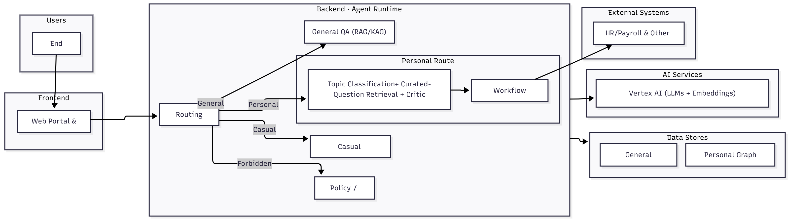
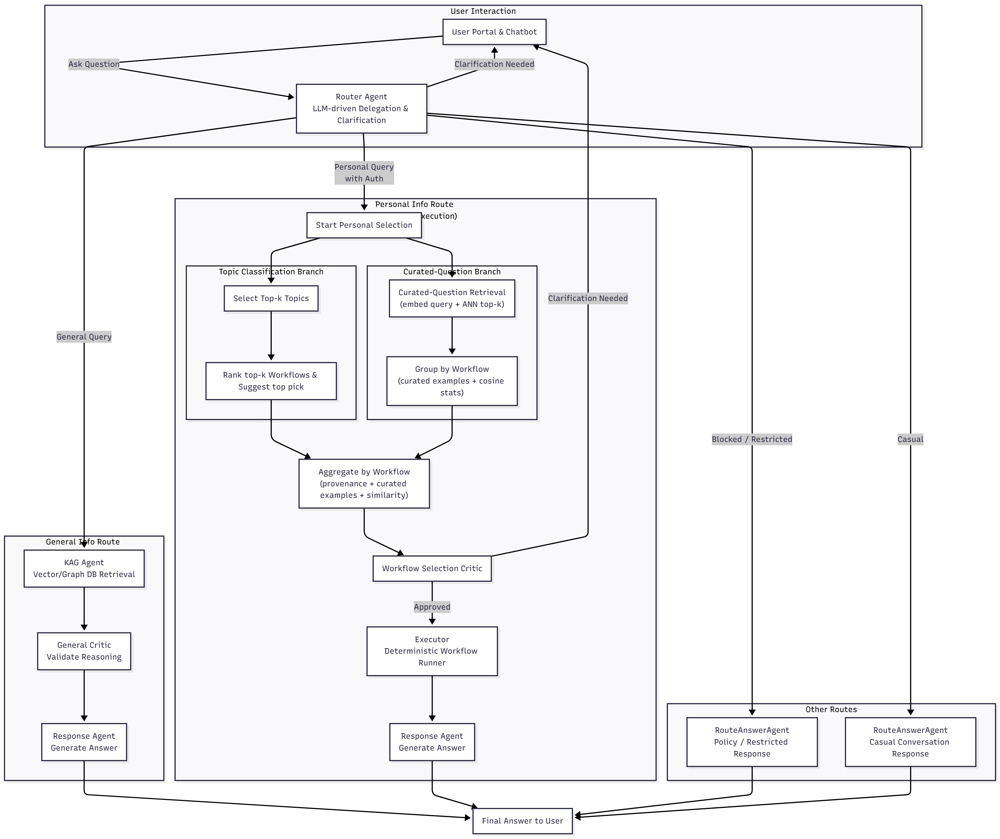
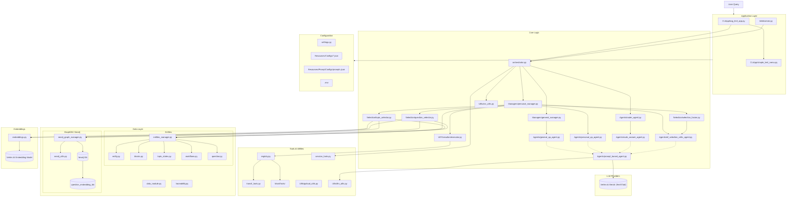

# Manual / Developer Guide (Web‑App Focus)

30 minutes orientation.  
Narrative overview + code refs.

## 1) Overview & Goals

The system is a **multi-agent, knowledge-augmented question answering (QA) solution**, deployed on **Google Cloud**,
that handles both **general** and **personal** queries. It enables both **general information retrieval** and
**personalized, authenticated services**, adapting dynamically based on the user’s query type.

A routing agent chooses the route:

- **General** (KAG) — knowledge‑augmented answers without personal data.
- **Personal** — authenticated **workflow execution** with deterministic blocks.

 <ins>**Core personal flow:**</ins> 
**Router → Workflow selection (configured: TopicSelector or UnifiedWorkflowSelector) + Curated-Question ANN (parallel)
→ Aggregator (by workflow with provenance) → Critic (validate/clarify with `retry_phase`) → Deterministic Executor
→ Final Answer**.

The **personal** route deterministically executes **workflows** chosen by combining **Topic-based Traversal** with *
*Curated‑Question** ANN retrieval (Cosine Similarity). An **Aggregator** fuses candidates **by
workflow** (no cross‑score re‑rank), annotating **provenance**. A **Critic** either **accepts** or asks **one** concise
clarification (Hebrew). **Workflow execution is deterministic**. LLMs (Vertex GenAI) are used for routing, traversal
re‑rank, critic reasoning, and final phrasing.

Backends: **Pandas** (topic graph + curated questions + question vector index) and **Google Vertex GenAI** (LLMs +
embeddings).

### Essential Hebrew glossary (compact)

| English                  | Hebrew (תרגום)        | Notes                                                                                                         |
|--------------------------|-----------------------|---------------------------------------------------------------------------------------------------------------|
| Router                   | נתב                   | Chooses general/personal/blocked/casual                                                                       |
| Workflow selector        | מסווג רצפי פעולות     | Selection stage that returns a ranked `wf_beam` (configured method: topic \| unified)                         |
| TopicSelector            | מסווג לפי נושאים      | Method: **2 LLM calls** (state ranking → workflow ranking), used when `workflow_selection.selection_method="topic"` |
| UnifiedWorkflowSelector  | מסווג מאוחד           | Method: **1 LLM call** to rank workflows; receives `wf_candidates` + `states_json` context                    |
| Curated Question         | שאלה                  | Pre‑authored, linked to a single workflow, stored + embedded                                                  |
| Workflow                 | רצף פעולות (בלוקים)   | Pre‑authored sequence (DAG) of blocks to run and conditions to control flow.                                  |
| Aggregator (by workflow) | מקבץ/רכז              | Merges traversal/ANN per workflow, preserves traversal order                                                  |
| Provenance               | מקור                  | “Topic Classification” / “Question Similarity” / “Topic Classification + Question Similarity”                 |
| Critic                   | מבקר בחירת רצף פעולות | Validates selection; asks one concise clarification (Hebrew)                                                  |
| Executor                 | מריץ                  | Deterministic workflow blocks (no LLM math)                                                                   |
| Bounded Conv. Memory     | זיכרון שיחה מוגבל     | Last N mains passed to LLMs per agent                                                                         |
| ANN (vector index)       | חיפוש בקירוב          | Over Question embeddings for curated questions (Approximate Nearest Neighbor)                                 |

## 2) High‑Level Architecture

### Personal route sequence

## 3) Key Components & Flows (code pointers)

### Orchestrator

- `Core/routing_orchestrator.py` → `Orchestrator.ask_async`, `_handle_query_start`, `_handle_query_continue`, `_run_decomposed`
- Central coordinator. In **remote mode** it runs as a stateless Orchestrator service and talks to the Personal/General
  services via `AsyncSessionsClient`, `AsyncPersonalServiceClient`, and `AsyncGeneralServiceClient` (RemoteMode is async-only at the FastAPI boundary). In **local mode** (used by
  `main.py` and simple web runs) it uses in-process adapters (`LocalSessionsAdapter`, `LocalPersonalAdapter`,
  `LocalGeneralAdapter`) that wrap the same managers.
- Returns an `Answer` object that always includes `text`, and—when relevant—`facts`, `cursor`, and `pending` + `need`
  (for UI prompts).

**High-level flow (including decomposition):**
- New message → `RouterAgent.decompose_and_route(...)`:
  - `restricted` / `casual` → handled immediately
  - `clarify` → raises `InputNeeded` (whole query)
  - `decomposed` → create **submains** (one per sub-query)
- Run **personal** submains **sequentially** (interactive):
  - On first `InputNeeded` for a submain → prefix a short “split progress” message (router `intro` preferred) and persist
    `pending_input` + `current_sub_id` for resume.
- After personal stage completes → run **general** submains **in parallel** (async fan-out, bounded by a semaphore).
- Compose a single final answer via `AnswerComposerAgent` and enforce its restriction decision.
- Aggregate `used_info` across submains and preserve it as **metadata** on the final answer.

### Router (Decomposer + Router)

- `Core/Agents/router_agent.py` → `RouterAgent.decompose_and_route`
- LLM-based decomposition + routing:
  - `decomposed` → `sub_queries[]` each with `route: personal|general`, `query`, and optional `intro`
  - `clarify` → raises `InputNeeded` (whole query)
  - `restricted` / `casual` → handled immediately
- Reads restrictions from `Resources/PromptConfigs/restriction.json`.
- Prompt configuration: `Resources/PromptConfigs/prompts.py` → `router_decomposer` (the `...` placeholders are intentional).

### Answer composition (LLM-based)

- `Core/Agents/answer_composer_agent.py` → `AnswerComposerAgent.compose(...)`
- Prompt configuration: `Resources/PromptConfigs/prompts.py` → `answer_composer`
- Input: original user query + list of sub-queries with their answers (answers are passed cleanly; `used_info` is treated as metadata).
- Output:
  - `final_answer`
  - `is_restricted`
  - `restricted_message`
- Orchestrator enforces the decision:
  - if `is_restricted=true` → return `restricted_message`
  - else → return `final_answer`

### Registries (Tools & Actions)

- **Tool Registry:** Inmemory map name → callable. Built by ToolFactory.create_tool_registry, which wires:
    - TOOL_MAPPING (pure functions, e.g., *get_user_id, is_date_in_range*),
    - ENDPOINT_TOOL_MAPPING (HTTP calls via EndpointHandler),
    - MOCK_* mappings (if debug_active), wrapping mocks to inject fixtures.
- **Action Registry:** Declarative **actions** from specs expanded into **flat step sequences** (expanded_steps) by
  following nested tool_name references (actions can call actions or tools). Each step carries params and a return_data
  key telling the executor where to put the result in **facts**.
- **Initialization:** Executor.__init__ calls init_registry(...) to build tool + action registries from
  data_specs['tools'], data_specs['actions'], plus autowrapping **Blocks** into **Actions** (make_block_action_def).
- **Execution contract:** Executor._run_tool_step(...) asks ActionRegistry.get_step(...) for the next step, calls
  ToolRegistry.call(...), then writes the step's return_data into facts. Conditions in workflow edges read from fact to
  pick next blocks.
- **Option Selection tools** are part of the Tool Registry:
    - `Tools/session_store.py` → `get_selection_from_user` (prompts user, returns `selected_index`),
      `select_option` (resolves the chosen item to `selected_option_details`).
    - Declared in `Resources/Specs/transit_tools.json`.

- **Composite Action expansion**:
    - Actions like `get_selected_option_from_user` (in `transit_actions.json`) compose the two tools above.
    - Nested actions are expanded into flat `expanded_steps` with proper `return_data` routing.

- **doc_outputs forwarding with levels**:
    - The Action Registry tags each (nested) action with a `doc_outputs_level`.
    - Higher-level (outer) actions have higher precedence when the Executor merges documentation outputs.

### Workflow selection (TopicSelector / UnifiedWorkflowSelector)

Selection is **configurable** via `settings.workflow_selection["selection_method"]`:
- `"topic"` → `TopicSelector` (two LLM calls: rank terminal topic states → rank workflows in selected topics)
- `"unified"` → `UnifiedWorkflowSelector` (single LLM call: rank workflows directly)

Code pointers:
- `Core/WorkflowSelection/SelectByTopicClassification/topic_selector.py` → `TopicSelector.select(...)`
- `Core/WorkflowSelection/SelectByUnifiedAgent/unified_selector.py` → `UnifiedWorkflowSelector.select(...)`
- Wiring: `Core/Managers/personal_manager.py` → chooses selector by `workflow_selection.selection_method`

Common contract (both selectors):
- Inputs: `user_query`, `user_query_embed`, and bounded `conv_history`
- Output: `(wf_beam, topic_selector_cand_wf_id)`
- Persistence: `PersonalManager` stores results under `facts["wf_selection"]` and advances the cursor to `critic_workflow`

Representation & caching:
- Both selectors build a `states_json` snapshot of **terminal topic states** (formats: `flat` | `nested`) with an in-memory TTL cache.
- `state_top_k` controls how many terminal topics are considered before workflow ranking (token-budget knob). When unset/≤0, selectors may include all terminal topics.

### Curated‑Question Selector (ANN)

- `Core/WorkflowSelection/SelectByQuestion/question_selector.py` → retrieve_and_summarize
- ANN over Question embeddings in**Neo4j**; Retrieve the questions' workflows; groups hits **by workflow**; carries
  similarity stats and questions' texts.

### Aggregator (by workflow)

- `Core/WorkflowSelection/selection_fusion.py` → aggregate_candidates, format_candidates
- **Combines** Topic Classification + question **by workflow**; annotates **provenance**; outputs traversal‑present
  first, then
  question‑only by cosine.
    - Provenance as source: Topic Classification / Question Similarity / both.
- Output order: Topic Classification-present first (keeps beam order), then question-only (by max cosine).

### Critic (WorkflowSelectionCritic)

- `Core/Agents/wf_selection_critic_agent.py` → WorkflowSelectionCriticAgent.judge
- Treats beam vs cosine as **non‑comparable**; relies on **provenance + curated‑question ****fit**.
- **Accepts** or asks **one** concise Hebrew clarification; may ask for one clarification and return **`retry_phase`**:
  `select_workflow` (redo selection + aggregation) or `critic_workflow` (keep candidates, redo final selection).

### Executor

- `Core/WFExecution/executor.py` → Executor.run
- Deterministic workflow block runner (uses tools, actions ,endpoints from specs); can return InputNeeded prompts if
  information is needed from the user mid-execution.
- **Doc Outputs Merge & Precedence (new)**  
  If an action defines `doc_outputs`, the Executor merges them into `facts["wf_doc_output"]`.
    - Merge uses the `doc_outputs_level` attached by the registry.
    - On key conflicts, **outer action values override inner action values**.

  This guarantees top-level action descriptions control the final doc view while preserving inner outputs when
  non-conflicting.

### Option Selection mechanic (new)

Purpose: allow a workflow to ask the user to pick a specific item from previously returned options.

**Flow:**

1) A prior step writes an options collection to `facts` (e.g., a list/table of rows).
2) `get_selection_from_user` prompts, validates, and writes `selected_index`.
3) `select_option` maps `selected_index` → `selected_option_details` (the chosen row/object).
4) Composite action `get_selected_option_from_user` bundles (2)→(3) to reduce boilerplate.

### Sessions & Bounded Memory

- `Tools/session_store.py` → `SessionStore`, `build_bounded_conv_history(...)`
- The session store is **split-aware**:
  - A parent “main” can have multiple **submains** (`submain_ids`), each with its own facts / cursor / pending input /
    answer / `used_info`.
  - Resume after `InputNeeded` uses `current_sub_id` to continue the active submain.
- Orchestrator passes **agent-specific** last‑N *main* messages to LLM calls to keep context tight and explainable.

## 4) Data & Graph Model

- **Entities** (DataLayer/Entities/*.py):
    - TopicState, Workflow, Question, Block.
- **Neo4j integration** (DataLayer/GraphDB/Neo4j/*.py):
    - (:State)-[:CHILD_OF]->(:State)
    - (:Workflow)-[:WORKFLOW_OF]->(:State)
    - (:Question)-[:QUESTION_OF]->(:Workflow)
    - (:Workflow)-[:USES_BLOCK]->(:Block)
- neo4j_graph_manager.py for CRUD, constraints, and vector indexes.

## 5) Ingestion Overview

1. Read specs from `Resources/Specs/transit_*.json`.
2. `DataLayer/Entities/entities_manager.py` embeds text via **Vertex** (`Core/Embeddings/embeddings.py`) and **creates
   nodes/edges** in Neo4j using `neo4j_utils.py`.
3. **Curated Questions** are read from CSV (`Resources/PersonalQuestions/*.csv`) as (:Question) nodes linked to
   workflows; create ANN index.
4. <ins>At runtime</ins>: QuestionSelector reuses ANN hits; the Aggregator ensures **each candidate** reaches the Critic
   with curated questions.

## 6) Vertex GenAI Integration (LLM + Embeddings)

- **Client** *Google.genai* (*Vertex AI*) init via `Utils/gcloud_utils.py`.
- **Embeddings**: `Core/Embeddings/embeddings.py` using *text-multilingual-embedding-002*.
- **Prompt‑based agents**: `Core/Agents/prompt_based_agent.py` (+ router/traversal/critic/QA specific prompt).
- Every call includes **bounded conversation history** supplied by SessionStore.

## 7) Configuration & Environment

- `Config/settings.py` loads/overrides via settings.update("`Resources/SystemConfigs/exp_1_create_dbs.json`").
- **Specs (updated)**: States, Blocks, Actions, Endpoints, and W...s/Specs/transit_*.json` and reflect the latest spec
  drop (see repo).
- SystemConfig now also includes a `services` section for base URLs when running in 3-service mode (e.g.,
  `personal_base_url`, `general_base_url`). Orchestrator reads these when `ORC_MODE=remote`.
- `ORC_MODE` environment variable controls wiring:
    - `local` (default) → use Local*Adapter classes (single-process LocalMode).
    - `remote` → use HTTP clients pointing at the Personal/General services (Docker / Cloud Run).

## 8) Cursor & Facts (RESTful continuation)

- **Facts**: context memory (tool outputs + user inputs).
- **Cursor**: compact pointer to resume exactly where execution paused:
    - <ins>phase</ins> (e.g., choose_child → choose_workflow/critic_workflow → selected_workflow → run_block_action →
      answered)
    - phase_idx (which step in the expanded action)
- On InputNeeded, the system sets pending=true and the API returns a token that points to the facts and cursor along
  with the conversation history.

## 9) Operational Notes.

- Common failure modes: bad SystemConfig paths, Neo4j down/creds mismatch, ADC missing, LLM parse mismatch.
- Local dev loop: run Neo4j, verify configs, start FastAPI, test /api/send and observe beam/aggregation in logs.

## 10) How to run (minimal)

1. **Python deps** use requirements:

2. **Vertex AI auth (ADC)**:
   `gcloud auth application-default login`

[//]: # (3. **Neo4j**: run locally &#40;`neo4j://127.0.0.1:7687`&#41;, set creds; db names come from SystemConfigs JSON.)

3. **Configure system**: Open `Resources/SystemConfigs/exp_1_create_dbs.json` → fix local paths.
   Key knobs:
   - `workflow_selection.selection_method` (`topic` | `unified`)
   - `workflow_selection.selector_hyperparams.{state_top_k, wf_top_k, states_representation (flat|nested), cache_ttl_minutes}`
   - `workflow_selection.critic_max_clarifications`
   - `workflow_selection.personal_questions.*`

4. **Start**:
    - **LocalMode CLI** (single process): `python main.py`
    - **Web (single process, dev)**: `SERVER_THREADPOOL_WORKERS=32 uvicorn Web.server:app --reload --port 8000 --limit-concurrency 50 --backlog 2048` (defaults to LocalMode if `ORC_MODE`
      is not set).
    - **Full 3-service stack (Docker)**: `docker compose up` (starts orchestrator + personal + general services,
      orchestrator running in `ORC_MODE=remote`).

<ins>**Smoke test:**</ins> Send a personal query (e.g., "חויבתי פעמיים על נסיעה אתמול, אפשר לבדוק?"). Expect:
Router → personal,
workflow selection produces a `wf_beam`, candidates aggregated with **provenance**, Critic decision,
workflow execution, final Hebrew
answer.

## 11) Happy‑path demo (from real entrypoints)

1. **Web**: POST /api/send → Orchestrator.ask_async(...).
2. **Router** picks **personal**.
3. **Workflows candidates** discovery
    1. TopicSelector classify and rank top-k terminal states. Then classify and rank the topics' workflows (top-k
       workflows and proposes a **top‑1 candidate**).
    2. **In parallel**: **Curated‑Question ANN** retrieves by workflow.
4. **Aggregator** merges **by workflow**, annotates **provenance**.
5. **Critic** agent either **accepts** or **asks for clarification** - one question.
   Returns a **`retry_phase`** of `state_selection` (redo TopicSelector) or `critic_workflow` (redo final selection).
6. **Executor** runs Workflows' blocks **deterministically** based on the defined blocks DAG and returns a short,
   professional answer.

## 12) “Where in code” map (jump points)

| Concept                  | Path → Class / Fn                                                                                              |
|--------------------------|----------------------------------------------------------------------------------------------------------------|
| API (FastAPI)            | Web/server.py → app, POST /api/send                                                                            |
| Personal service API     | Web/personal_server.py → FastAPI app for sessions + personal route (`/personal/*`, `/health`)                  |
| General service API      | Web/general_server.py → FastAPI app for general QA (`/general/*`, `/health`)                                   |
| HTTP clients / adapters  | Core/Clients/* → AsyncSessionsClient / AsyncPersonalServiceClient / AsyncGeneralServiceClient + Local*Adapter + AsyncLocal*Adapter |
| Orchestrator             | Core/routing_orchestrator.py → Orchestrator.ask_async, _handle_query_start, _handle_query_continue, _run_decomposed |
| Main                     | main.py -> for testing without running the server                                                              |
| Router (decomposer)      | Core/Agents/router_agent.py → RouterAgent.decompose_and_route                                                                 |
| TopicSelector            | Core/WorkflowSelection/SelectByTopicClassification/topic_selector.py → TopicSelector.select                     |
| Unified selector         | Core/WorkflowSelection/SelectByUnifiedAgent/unified_selector.py → UnifiedWorkflowSelector.select               |
| State ranking agent      | Core/Agents/topic_ranking_agent.py → TopicRankingAgent.rank                                                    |
| Workflow ranking agent   | Core/Agents/workflow_ranking_agent.py → WorkflowRankingAgent.rank                                              |
| Curated Qs (ANN)         | Core/WorkflowSelection/SelectByQuestion/question_selector.py → QuestionSelector.retrieve_and_summarize         |
| Aggregator (by workflow) | Core/WorkflowSelection/selection_fusion.py → aggregate_candidates, format_candidates                           |
| Critic                   | Core/Agents/wf_selection_critic_agent.py → WorkflowSelectionCriticAgent.judge                                  |
| Executor (blocks)        | Core/WFExecution/executor.py → Executor.run                                                                    |
| Sessions & memory        | Tools/session_store.py → SessionStore, build_bounded_conv_history (submains + current_sub_id resume)                              |
| Embeddings / Vertex      | Core/Embeddings/embeddings.py, Utils/gcloud_utils.py                                                           |
| Specs (JSON, updated)    | Resources/Specs/transit_states.json / transit_blocks.json / transit_actions.json / transit_endpoints.json / transit_workflows.json |

## 13) Limits & Caveats

- **Never** compare beam score to cosine magnitude; rely on **provenance + curated Qs**.
- Clarify loop is **single‑turn**, may include **reroute**. Has Limit on number of clarifications possible.
- In‑memory sessions by default; use Redis for multi‑instance durability.

## 14) Open Issues & Future Work

- Better web architecture and UX.
- **Scale Topic-Classification selector** (token budgeting via chunking/tournament; optional “skip WF ranking” path if
  state selection is decisive).
- Improve retries + observability (structured logs, timings, token usage).
- Harden auth/session.
- Metrics: beam coverage, critic clarify rate, execution latency.
- Admin ops: refresh DBs, rebuild vector indexes.
- Config hardening: repo‑relative paths +.env‑style secrets.
- General queries route.

### Appendix: General Route (KAG) — quick note

- KAG agent retrieves from graph/vector KB (FAQs, documents). Context is provided to the LLM for answer synthesis. A
  Critic may validate reasoning.

### Appendix: Detailed Diagrams

<ins>System Architecture</ins>

