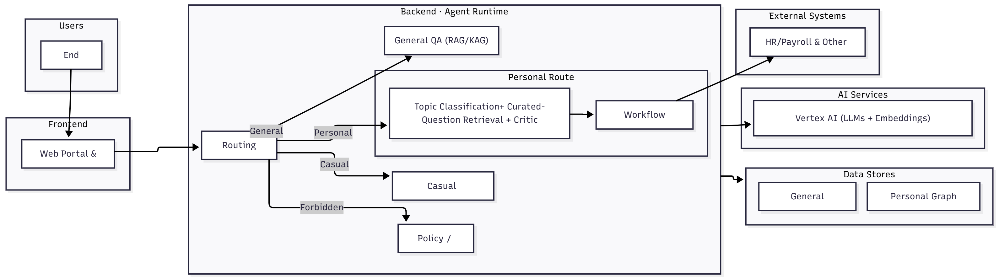

# One-Page Quickstart (Orientation-First)

5–15 min orientation.  **What** the system is, **how** it flows, and **where** to look in code.

## What this system is (briefly)

A multi-agent, knowledge-augmented Q&A web app that supports two routes:

A single user query may be **decomposed into multiple atomic sub-queries** (personal + general) which are executed with different strategies and then composed into one final answer.

- **General** (KAG) — knowledge-augmented answers without personal data.
- **Personal** — authenticated **workflow execution** with deterministic blocks.

**Core flow (high level):**  
**Router (Decomposer) → personal sub-queries (sequential; each: Workflow Selection (TopicSelector or UnifiedWorkflowSelector) + Curated-Question ANN → Aggregator → Critic → Executor) → general sub-queries (parallel, after personal) → AnswerComposer → Final Answer**.

Backends: **Pandas** (topic graph + curated questions + question vector index) and **Google Vertex GenAI** (LLMs + embeddings).

### Compact Hebrew glossary (critical terms)

| English                  | Hebrew (תרגום)        | Notes                                                                                                          |
|--------------------------|-----------------------|----------------------------------------------------------------------------------------------------------------|
| Router                   | נתב                   | Chooses general/personal/blocked/casual                                                                        |
| Workflow selector        | מסווג רצפי פעולות     | Configurable: **TopicSelector** (2 LLM calls) or **UnifiedWorkflowSelector** (1 LLM call)                      |
| TopicSelector            | מסווג לפי נושאים      | 2 LLM calls: (1) rank terminal topics from cached states JSON; (2) rank workflows from top-k topics            |
| Unified selector         | מסווג מאוחד           | 1 LLM call: rank workflows; may use topic graph as context / optional topic prefilter                          |
| Curated Question         | שאלה                  | Pre-authored, linked to a single workflow, stored + embedded                                                   |
| Workflow                 | רצף פעולות (בלוקים)   | Pre-authored sequence (DAG) of blocks to run and conditions to control flow.                                   |
| Aggregator (by workflow) | מקבץ/רכז              | Merges selector + ANN results by workflow, preserves provenance                                                 |
| Provenance               | מקור                  | “Topic Classification” / “Question Similarity” / “Topic Classification + Question Similarity”                  |
| Critic                   | מבקר בחירת רצף פעולות | Validates selection; asks one concise clarification (Hebrew)                                                   |
| Executor                 | מריץ                  | Deterministic workflow blocks (no LLM math)                                                                    |
| Bounded Conv. Memory     | זיכרון שיחה מוגבל     | Last N mains passed to LLMs per agent                                                                          |
| ANN (vector index)       | חיפוש בקירוב          | Over Question embeddings for curated questions (Approximate Nearest Neighbor)                                  |

## Architecture at a glance

**Deployment shape (services + LocalMode)**

- **Local mode (single process)** — `Orchestrator` + personal/general routes run in one process (used by `main.py` and simple web runs).
- **3-service mode** — three FastAPI apps:
    - Orchestrator (`Web/server.py`) — stateless, talks to Personal/General over HTTP.
    - Personal (`Web/personal_server.py`) — owns sessions + personal workflows.
    - General (`Web/general_server.py`) — stateless general QA.  
      Orchestrator switches between these using `ORC_MODE` + service URLs from config/env.

## Happy-path demo (from real entrypoints)

1. **Web**: POST `/api/send` → `Orchestrator.ask_async(...)`.
2. **Router** picks **personal**.
3. **Workflow candidates** discovery:
    1. **Workflow selection** runs (configured selector):
        - **TopicSelector**: rank top-k terminal topics → rank workflows from those topics → produce `wf_beam` + top candidate id.
        - **UnifiedWorkflowSelector**: build topic context (`states_json`) + pass explicit `wf_candidates` → single LLM ranking → produce `wf_beam` + top candidate id.
    2. **In parallel**: **Curated-Question ANN** retrieves candidates grouped by workflow.
4. **Aggregator** merges **by workflow**, annotates **provenance**.
5. **Critic** agent either **accepts** or **asks for clarification** (one question).  
   Returns a `retry_phase` of `state_selection` (redo workflow selection) or `critic_workflow` (redo final selection).
6. **Executor** runs the selected workflow’s blocks **deterministically** based on the workflow DAG and returns a short, professional answer.

## Workflow Execution Key Points

### Registries & Executor

- Blocks are actions: blocks are wrapped so workflows run uniformly through the action engine.
- Actions expand to steps: actions may call tools or other actions; expansion produces a flat `expanded_steps` list.
- Executor loop: for each step → call tool via `ToolRegistry.call(...)` → write the tool’s `return_data` into **facts** → follow workflow edges using **facts** to pick the next block.

### Cursor & Facts — how continuation works

- **Facts** = context memory (tool outputs + user inputs).
- **Cursor** = compact pointer to resume exactly where execution paused:
  - phase (e.g., choose_child → choose_workflow/critic_workflow → selected_workflow → run_block_action → answered)
  - phase_idx (which step in the expanded action)
- On `InputNeeded`, the system sets `pending=true` and persists the prompt **on the active submain**; resume uses `current_sub_id` to continue exactly where execution paused. The API returns a token that points to the facts/cursor along with the conversation history.

## “Where in code” map (jump points)

| Concept                  | Path → Class / Fn                                                                                              |
|--------------------------|----------------------------------------------------------------------------------------------------------------|
| API (FastAPI)            | `Web/server.py` → app, POST `/api/send`                                                                        |
| Personal service API     | `Web/personal_server.py` → FastAPI app for sessions + personal route (`/personal/*`, `/health`)                |
| General service API      | `Web/general_server.py` → FastAPI app for general QA (`/general/*`, `/health`)                                 |
| HTTP clients / adapters  | `Core/Clients/*` → AsyncSessionsClient / AsyncPersonalServiceClient / AsyncGeneralServiceClient + Local*Adapter + AsyncLocal*Adapter               |
| Orchestrator             | `Core/routing_orchestrator.py` → Orchestrator.ask_async, _handle_query_start, _handle_query_continue, _run_decomposed                        |
| Main                     | `main.py` → run without servers (LocalMode)                                                                    |
| Router (decomposer)      | `Core/Agents/router_agent.py` → RouterAgent.decompose_and_route                                                |
| TopicSelector            | `Core/WorkflowSelection/SelectByTopicClassification/topic_selector.py` → TopicSelector.select                  |
| Unified selector         | `Core/WorkflowSelection/SelectByUnifiedAgent/unified_selector.py` → UnifiedWorkflowSelector.select            |
| State ranking agent      | `Core/Agents/topic_ranking_agent.py` → TopicRankingAgent.rank                                                  |
| Workflow ranking agent   | `Core/Agents/workflow_ranking_agent.py` → WorkflowRankingAgent.rank                                            |
| Unified ranking agent    | `Core/Agents/unified_workflow_selection_agent.py` → UnifiedWorkflowSelectionAgent.rank                         |
| Curated Qs (ANN)         | `Core/WorkflowSelection/SelectByQuestion/question_selector.py` → QuestionSelector.retrieve_and_summarize       |
| Aggregator (by workflow) | `Core/WorkflowSelection/selection_fusion.py` → aggregate_candidates, format_candidates                         |
| Critic                   | `Core/Agents/wf_selection_critic_agent.py` → WorkflowSelectionCriticAgent.judge                                |
| Executor (blocks)        | `Core/WFExecution/executor.py` → Executor.run                                                                  |
| Sessions & memory        | `Tools/session_store.py` → SessionStore, build_bounded_conv_history (submains + current_sub_id resume)         |
| Embeddings / Vertex      | `Core/Embeddings/embeddings.py`, `Utils/gcloud_utils.py`                                                       |
| Specs (JSON)             | `Resources/Specs/transit_states.json` / `transit_blocks.json` / `transit_actions.json` / `transit_endpoints.json` / `transit_workflows.json` |

## How to run (minimal)

1. **Python deps**: `pip install -r requirements.txt`

2. **Vertex AI auth (ADC)**:  
   `gcloud auth application-default login`

3. **Configure system**: open `Resources/SystemConfigs/exp_1_create_dbs.json`  
   Key knobs:
   - `workflow_selection.selection_method` (`topic` or `unified`)
   - `workflow_selection.selector_hyperparams.{state_top_k, wf_top_k, states_representation (flat|nested), cache_ttl_minutes}`
   - `workflow_selection.personal_questions.*`
   - `workflow_selection.critic_max_clarifications`

4. **Start**:
    - **LocalMode CLI** (single process): `python main.py`
    - **Web (single process, dev)**: `SERVER_THREADPOOL_WORKERS=32 uvicorn Web.server:app --reload --port 8000 --limit-concurrency 50 --backlog 2048` (defaults to LocalMode if `ORC_MODE` is not set).
    - **Full 3-service stack (Docker)**: `docker compose up` (starts orchestrator + personal + general services; orchestrator runs in `ORC_MODE=remote`).

<ins>**Smoke test:**</ins> Send a personal query (e.g., "חויבתי פעמיים על נסיעה אתמול, אפשר לבדוק?"). Expect:
Router → personal,
a `wf_beam` produced by the configured selector, candidates aggregated with **provenance**, Critic decision,
workflow execution, final Hebrew answer.

## Limits & caveats

- Selector scores vs cosine similarities are **not** comparable → Critic relies on **provenance + curated examples**.
- Config JSON examples may include machine-specific paths → adapt to your environment.
- Session memory is split-aware (submains + resume via `current_sub_id`).

## Open issues / future work

- Better web architecture and UX.
- Compare topic-based vs unified selection performance (coverage, latency, clarify rate).
- Improve retries + observability (structured logs, timings, token usage).
- Harden auth/session.
- General queries route.
